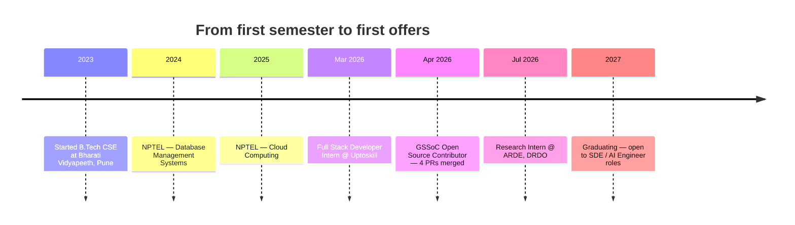
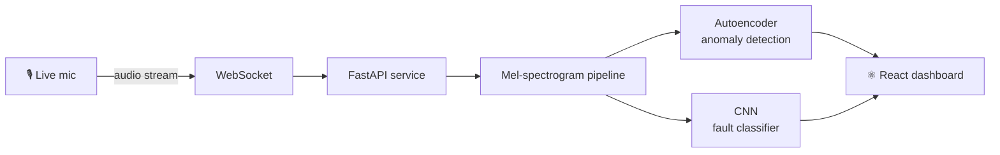
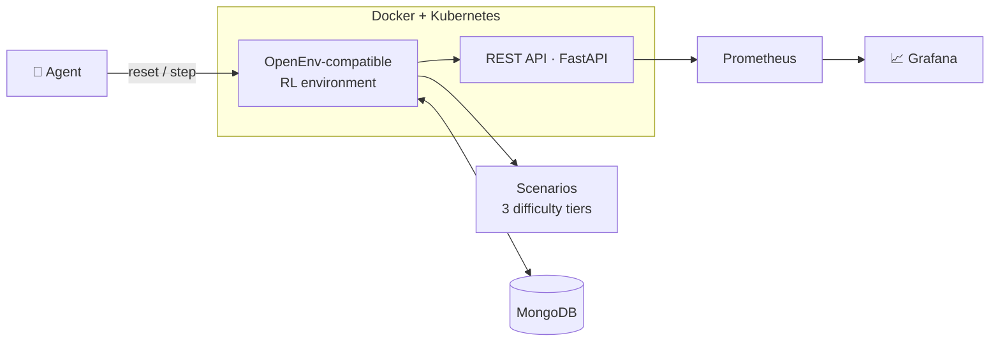
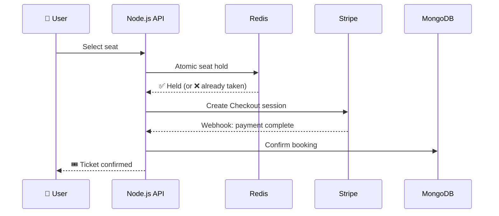
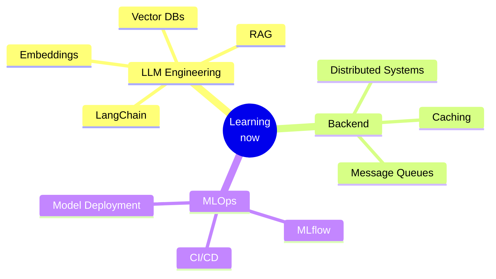

<!-- ===================== HEADER ===================== -->

<a href="#path">🧭 Choose your path</a> ·
<a href="#journey">Journey</a> ·
<a href="#experience">Experience</a> ·
<a href="#projects">Projects</a> ·
<a href="#challenge">Bug Challenge</a> ·
<a href="#stack">Tech Stack</a> ·
<a href="#achievements">Achievements</a> ·
<a href="#guestbook">Guestbook</a>

<!-- ===================== CHOOSE YOUR PATH ===================== -->
<h2 id="path">🧭 Choose Your Path</h2>

Click whichever sounds like you 👇

<b>👔 I'm a recruiter — give me the 30-second version</b>

 

> [!TIP]
> **Open to 2027 full-time SDE / AI Engineer roles.** Reach me at [sakshishukla1008@gmail.com](mailto:sakshishukla1008@gmail.com) or on [LinkedIn](https://linkedin.com/in/sakshishukla1008).

| | |
|---|---|
| 🎓 **Education** | B.Tech CSE, Bharati Vidyapeeth COE, Pune (2023 – 2027) |
| 📊 **CGPA** | 9.67 / 10.00 |
| 🔬 **Current** | Research Intern, ARDE, DRDO (Ministry of Defence) |
| 💻 **Previous** | Full Stack Developer Intern, Uptoskill |
| 🌱 **Open source** | GSSoC — 4 PRs merged ([verify](https://github.com/pulls?q=is%3Apr+author%3ASakshi-shukla01+is%3Amerged)) |
| 🛠️ **Core stack** | Python · FastAPI · Node.js · React · PostgreSQL · MongoDB · Redis · Docker · PyTorch |

<b>🧑‍💻 I'm a developer — show me the interesting code</b>

 

| If you like… | Look at |
|---|---|
| 🔒 Concurrency & race conditions | [QuickShow](https://github.com/Sakshi-shukla01/ticket-movie) — seat booking made safe with Redis atomic ops, covered by Jest/Supertest tests |
| 🤖 RL environments & agents | [Grid Fault RCA Agent](https://github.com/Sakshi-shukla01/grid-fault-agent) — OpenEnv-style `reset` / `step` API · [try the live API](https://sakshi898-grid-fault-agent1.hf.space/docs) |
| 🎧 Audio ML in real time | [SoundGuard](https://github.com/Sakshi-shukla01/soundguard) — mel-spectrograms, autoencoder anomaly detection, live mic over WebSocket |
| 🐳 Real-world OSS fixes | [My merged PRs](https://github.com/pulls?q=is%3Apr+author%3ASakshi-shukla01+is%3Amerged) — incl. a Docker startup race-condition fix |

<b>👋 Just browsing — tell me something fun</b>

 

- I'd rather **fix a real bug** than write about one.
- One of my projects **listens to machines** and tells you when they're about to break. 🎧
- I'm currently going deep on **LLMs, LangChain & RAG**.
- Try the 🐞 [bug challenge](#challenge) below, then sign the 📖 [guestbook](#guestbook)!

<!-- ===================== JOURNEY ===================== -->
<h2 id="journey">🗺️ My Journey</h2>

<!-- ===================== EXPERIENCE ===================== -->
<h2 id="experience">💼 Experience</h2>

Click a role to expand it.

🔬 <b>Research Intern (CSE)</b> · ARDE, DRDO — Ministry of Defence · <code>Jul 2026 – Present</code>

 

Paid research internship in the CSE discipline, supporting assigned technical research problems within a structured, mentorship-driven government research program.

💻 <b>Full Stack Developer Intern</b> · Uptoskill (Remote) · <code>Mar 2026 – May 2026</code>

 

- Built RESTful API endpoints (**Node.js, Express.js, PostgreSQL**) for an AI-powered LMS and troubleshot issues across agile sprint cycles.
- Contributed to a **Python (FastAPI)** microservice with **JWT** and **Firebase OAuth**.

🌱 <b>Open Source Contributor</b> · GirlScript Summer of Code · <code>Apr 2026 – Jun 2026</code>

 

- Fixed a **Docker startup race condition** and several frontend feature gaps across JS/TS and Python codebases.
- Merged **4 PRs**, including a `BackToTop` component and the Docker race-condition fix.
- Worked with maintainers through structured code-review cycles.

<a href="#top">⬆ back to top</a>

<!-- ===================== PROJECTS ===================== -->
<h2 id="projects">📌 Featured Projects</h2>

<table>
<tr>
<td width="33%" valign="top">

### 🎧 SoundGuard
Real-time acoustic predictive maintenance: detects and classifies machine faults from live audio.

`PyTorch` `FastAPI` `WebSocket` `React` `Docker`

</td>
<td width="33%" valign="top">

### ⚡ Grid Fault RCA Agent
Diagnostic agent that localizes grid faults, as an OpenEnv-compatible RL environment across 3 difficulty tiers.

`FastAPI` `MongoDB` `Docker` `Kubernetes` `Grafana`

</td>
<td width="33%" valign="top">

### 🎬 QuickShow
SaaS movie ticket booking platform built around concurrent seat reservation and payments.

`React` `Node.js` `MongoDB` `Redis` `Stripe`

</td>
</tr>
</table>

🔍 Open a project below to see how it works under the hood.

<b>🎧 SoundGuard — how it works</b>

 

- **Autoencoder** trained on normal-only sound — anything it can't reconstruct well is flagged as an anomaly
- **Supervised CNN** classifies the type of fault
- **Mel-spectrogram** pipeline turns raw audio into model input
- Live **mic → WebSocket** demo
- **Dockerized** multi-service setup

<b>⚡ Grid Fault RCA Agent — how it works</b>

 

- Custom RL env with a `reset` / `step` / scenarios API
- **MongoDB** data pipeline + REST endpoints
- **Docker + Kubernetes** deployment
- **Prometheus + Grafana** monitoring
- 👉 [Try the live API docs](https://sakshi898-grid-fault-agent1.hf.space/docs)

<b>🎬 QuickShow — how it works</b>

 

- Fixed seat-booking **race conditions** with Redis atomic ops
- **11 unit + integration tests** (Jest / Supertest)
- **Stripe Checkout + webhooks**, **Inngest** background jobs, **Clerk** auth

 
Also on the profile: UPI Fraud Detection · Interactive E-Learning Dashboard · Virtual Jewelry Try-On 

<a href="#top">⬆ back to top</a>

<!-- ===================== BUG CHALLENGE ===================== -->
<h2 id="challenge">🐞 Bug Challenge</h2>

**Two users click the *last* seat for the same show at the exact same millisecond.**
Both requests check the database, both see the seat as free, both proceed to payment.

**What goes wrong, and how would you fix it?** Think about it, then reveal 👇

<b>💡 Reveal the answer</b>

 

**The bug:** a classic *check-then-act* race condition. The "is it free?" check and the "book it" write are two separate steps, so both requests can slip through the gap between them — and the seat gets sold twice.

**The fix (what I did in QuickShow):** make the hold a single **atomic Redis operation**. Only one request can win the hold; the other gets an immediate "already taken" response — no double booking, no double charge. Then prove it with tests.

<!-- ===================== CONTRIBUTIONS ===================== -->
<h2 id="contributions">🟩 GitHub Contributions</h2>

<!-- These images are generated inside this repo by .github/workflows/snake.yml -->

<picture>
  <source media="(prefers-color-scheme: dark)" srcset="https://raw.githubusercontent.com/Sakshi-shukla01/Sakshi-shukla01/output/github-snake-dark.svg"/>
  
</picture>

 

<b>📊 Detailed stats (click to expand)</b>

 

<b>🏆 Trophies & Achievements (click to expand)</b>

 

<a href="https://github.com/pulls?q=is%3Apr+author%3ASakshi-shukla01">All PRs</a> ·
<a href="https://github.com/pulls?q=is%3Apr+author%3ASakshi-shukla01+is%3Amerged">Merged PRs</a> ·
<a href="https://github.com/issues?q=is%3Aissue+author%3ASakshi-shukla01">Issues</a> ·
<a href="https://github.com/search?q=author%3ASakshi-shukla01&type=commits">Commits</a>

<!-- ===================== TECH STACK ===================== -->
<h2 id="stack">🛠️ Tech Stack</h2>

| Area | Tools |
|---|---|
| **Languages** |  |
| **Backend** |  |
| **Frontend** |  |
| **Databases** |  |
| **Cloud & DevOps** |  |
| **ML & Testing** |  |

<b>🔗 Where I've actually used it (click to expand)</b>

 

| Tool | Used in |
|---|---|
| **FastAPI** | SoundGuard · Grid Fault RCA Agent · Uptoskill microservice |
| **Node.js / Express** | QuickShow · Uptoskill LMS APIs |
| **PostgreSQL** | Uptoskill LMS |
| **MongoDB** | QuickShow · Grid Fault RCA Agent |
| **Redis** | QuickShow (atomic seat locking) |
| **PyTorch** | SoundGuard (autoencoder + CNN) |
| **Docker** | SoundGuard · Grid Fault RCA Agent · GSSoC race-condition fix |
| **Kubernetes** | Grid Fault RCA Agent |
| **Prometheus / Grafana** | Grid Fault RCA Agent |
| **Jest / Supertest** | QuickShow (11 tests) |
| **React** | SoundGuard dashboard · QuickShow |
| **JWT / Firebase OAuth** | Uptoskill microservice |
| **Stripe · Inngest · Clerk** | QuickShow |

Also: RESTful APIs · JWT · Firebase OAuth · Webhooks · Background Jobs · Agile/Scrum · Prometheus/Grafana

<a href="#top">⬆ back to top</a>

<!-- ===================== ACHIEVEMENTS ===================== -->
<h2 id="achievements">🏆 Achievements & Certifications</h2>

<table>
<tr>
<td width="55%" valign="top">

**Achievements**

- 🌱 **GSSoC** — 4 PRs merged · [proof](https://github.com/pulls?q=is%3Apr+author%3ASakshi-shukla01+is%3Amerged)
- 🥇 **Smart India Hackathon** — Jharkhand heritage tourism platform · [certificate](https://drive.google.com/file/d/1pmrNRFLxXOyRUCfudqhxgn7WI4o8a4of/view)
- 🧠 **Tata Crucible Quiz** — cleared national prelims · [certificate](https://drive.google.com/file/d/1uqCCD4jPy9BTCFwUJeuC7b8tD_nbx5en/view)
- 🚀 **Young Turks, Naukri** — talent recognition · [certificate](https://drive.google.com/file/d/1Wv5oQ2gnqLdabfNOnjmlh2j9IUnkUdYj/view)

</td>
<td width="45%" valign="top">

**Certifications**

- OCI Gen AI Professional — *Oracle*
- OCI Foundations Associate — *Oracle*
- Cloud Computing — *NPTEL, 2025*
- Database Management Systems — *NPTEL, 2024*
- Java Programming — *IIT Bombay Spoken Tutorial*

</td>
</tr>
</table>

<b>📚 Currently learning (click to expand)</b>

 

<!-- ===================== GUESTBOOK ===================== -->
<h2 id="guestbook">📖 Guestbook</h2>

Made it this far? Leave a hello, a project idea, or feedback 👇

  
<a href="#top">⬆ back to top</a>

